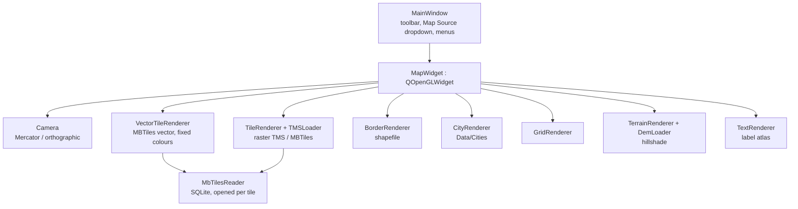
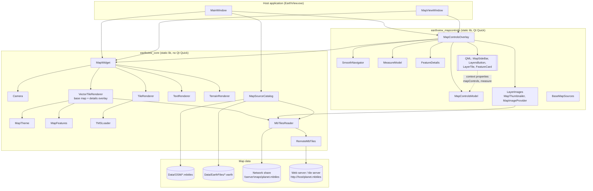
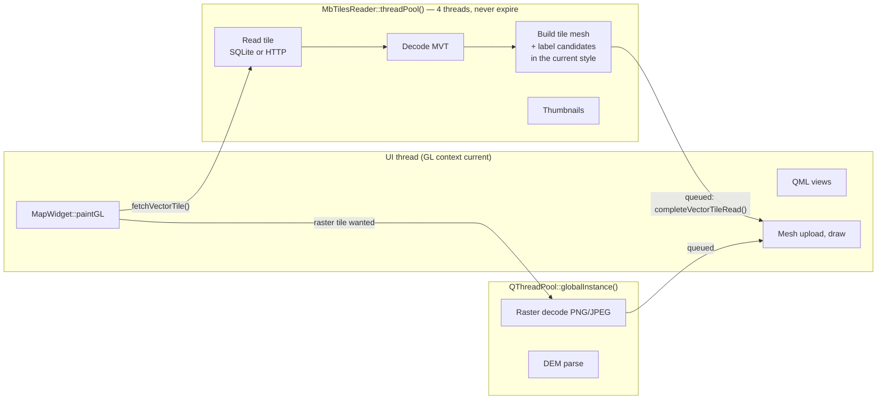
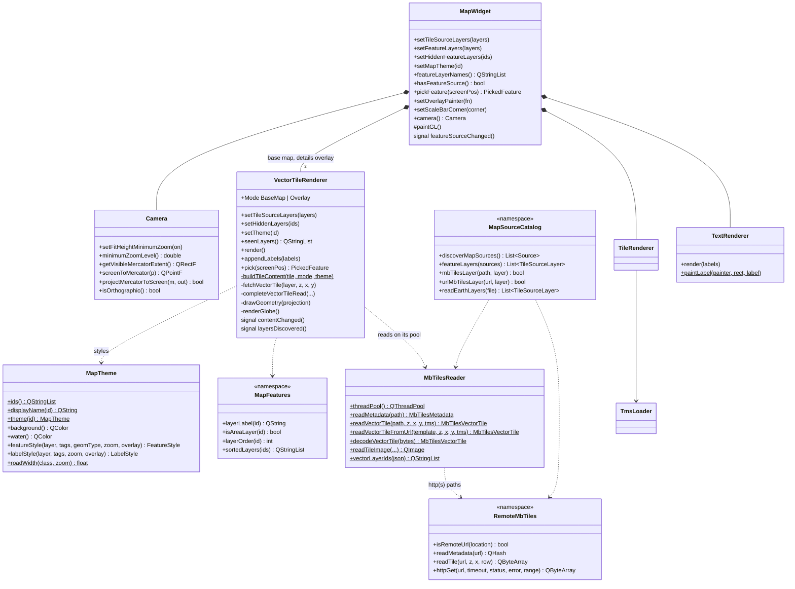
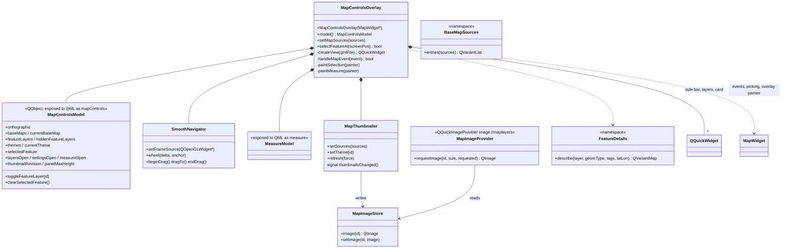
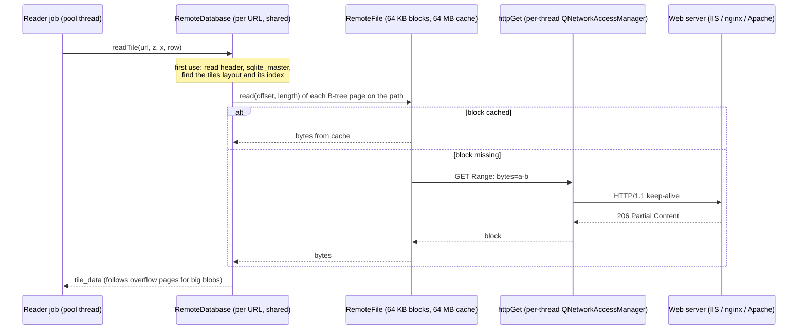
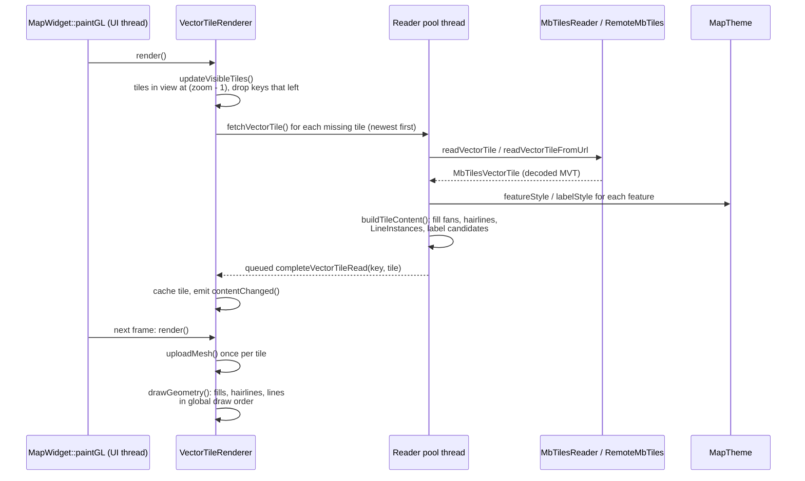
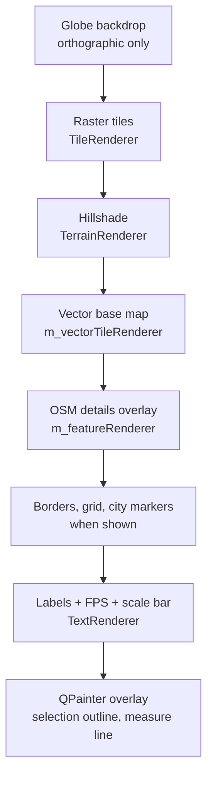
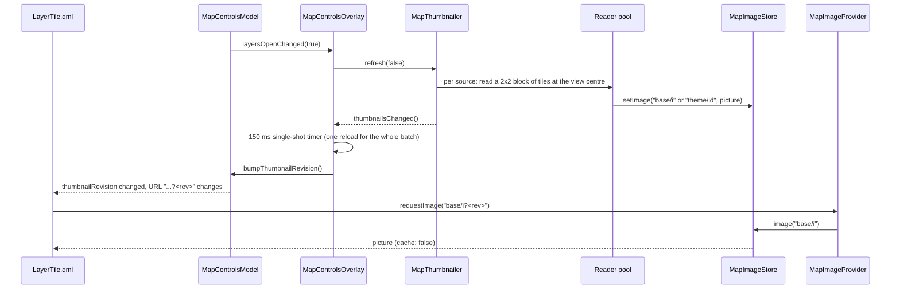
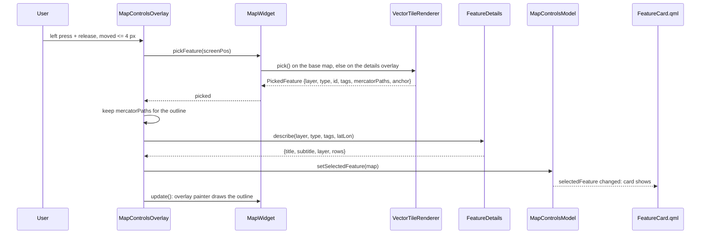

# EarthView: OSM-Styled MBTiles Maps with QML Controls — Development Guide

This guide explains, step by step, how the original EarthView 2D viewer became a Google-Maps-style
map: OSM vector MBTiles read from a local file, a network share or a web server, drawn in OSM
styles (Standard, Positron, Dark), with QML on-map controls, a Layers panel with live pictures,
clickable features and smooth navigation.

It matches the code of the map-controls pull requests #25 → #26 → #27 → #28 → #29 (branch
`2d/ui5-osm-details-url-mbtiles`). `MAP_CONTROLS_CHANGELOG.md` lists every file each PR added,
changed or removed; this guide explains **how the pieces work and how to build them again**.

> Diagrams use Mermaid. They render on GitHub and in VS Code (Markdown Preview Mermaid Support
> extension). On a machine without a renderer, the diagram source is still readable.

**Contents**

1. [Starting point: the original 2D engine](#1-starting-point-the-original-2d-engine)
2. [Target architecture](#2-target-architecture)
3. [Class structure](#3-class-structure)
4. [Step 1 — Build setup](#step-1--build-setup)
5. [Step 2 — Map sources and discovery](#step-2--map-sources-and-discovery)
6. [Step 3 — Fast MBTiles reads (file and share)](#step-3--fast-mbtiles-reads-file-and-share)
7. [Step 4 — MBTiles by URL (HTTP range requests)](#step-4--mbtiles-by-url-http-range-requests)
8. [Step 5 — Decoding vector tiles](#step-5--decoding-vector-tiles)
9. [Step 6 — Layer catalog and map styles](#step-6--layer-catalog-and-map-styles)
10. [Step 7 — Rendering the vector map](#step-7--rendering-the-vector-map)
11. [Step 8 — Labels](#step-8--labels)
12. [Step 9 — MapWidget integration](#step-9--mapwidget-integration)
13. [Step 10 — The QML overlay](#step-10--the-qml-overlay)
14. [Step 11 — `MapControlsModel`: the state QML binds to](#step-11--mapcontrolsmodel-the-state-qml-binds-to)
15. [Step 12 — The QML files](#step-12--the-qml-files)
16. [Step 13 — Live pictures in the Layers panel](#step-13--live-pictures-in-the-layers-panel)
17. [Step 14 — Picking a feature and the details card](#step-14--picking-a-feature-and-the-details-card)
18. [Step 15 — Smooth navigation](#step-15--smooth-navigation)
19. [Step 16 — Wiring it into a host](#step-16--wiring-it-into-a-host)
20. [Step 17 — Testing and verification](#step-17--testing-and-verification)
21. [Extending](#18-extending)
22. [Pitfalls and lessons learned](#19-pitfalls-and-lessons-learned)
23. [Known issues and open work](#20-known-issues-and-open-work)
24. [Appendix A — Files by step](#appendix-a--files-by-step)
25. [Appendix B — Glossary](#appendix-b--glossary)

---

## 1. Starting point: the original 2D engine

Before the map-controls work, EarthView's 2D viewer was a `QOpenGLWidget` with hand-written
OpenGL renderers and a Qt Widgets toolbar:



What had to change, and where it ended up:

| Area | Original | Now |
|---|---|---|
| Controls | Qt toolbar and menus | QML on-map controls over the GL map (side bar, Layers panel, details card) |
| MBTiles access | SQLite opened and closed for every tile; local files only | One read-only connection per reader thread; network share paths; **HTTP URLs** (range requests); tile servers |
| Vector styling | Hard-coded colours inside `VectorTileRenderer` | `MapTheme`: Standard (OSM Carto colours), Positron, Dark; a "hybrid" look over imagery |
| Vector geometry | Rebuilt for the whole view on the UI thread; 1-px lines | Per-tile meshes built on reader threads; instanced thick lines with round joins and dashes |
| Labels | Atlas repainted whenever the label set changed | Persistent atlas; halos; road names along the road; POI markers; collision grid |
| Place names, boundaries | `Data/Cities`, border shapefile | OSM layers (`place`, `boundary`) |
| Navigation | Stepped wheel zoom | Eased zoom, inertial pan, "fill the window" minimum zoom |
| Interaction | — | Click a feature: outline + details card; measure tool |
| Globe | CPU re-projection each frame | GPU projection (raster tiles, hillshade, vector map) |

---

## 2. Target architecture

### 2.1 Layers



### 2.2 Libraries

| Target | Kind | Depends on | Contains |
|---|---|---|---|
| `earthview_core` (`earthview::core`) | static library | Qt Core, Widgets, Network, OpenGL, OpenGLWidgets, Sql, zlib | `MapWidget`, `Camera`, all renderers and loaders, `MapTheme`, `MapFeatures`, `MbTilesReader`, `RemoteMbTiles`, `MapSourceCatalog`, shaders |
| `earthview_mapcontrols` (`earthview::mapcontrols`) | static library, optional | `earthview::core`, Qt Qml, Quick, QuickWidgets, Svg | The overlay, its model, navigation, measure, layer pictures, details, the QML files (compiled into the binary) |
| `EarthView` | application | both | `MainWindow`, `MapViewWindow`; built with `EARTHVIEW_HAS_MAP_CONTROLS` when the controls are on |

The core never includes Qt Quick, so other hosts can use the map without QML.

### 2.3 Threads



Rules that keep it smooth and safe:

- **Only the UI thread touches OpenGL.** Workers build plain vectors (`TileMesh`); the UI thread uploads them once.
- Results come back with `QMetaObject::invokeMethod(..., Qt::QueuedConnection)` guarded by a `QPointer`.
- Every job checks a shared `MbTilesRequestSet` first: tiles that left the view are skipped, never read.
- Jobs are started **newest first** (`QThreadPool::start(job, ++priority)`).
- Reader threads never expire, so their SQLite connections and HTTP keep-alive connections stay warm.
  They end when the application object is destroyed (a post routine), taking their network managers with them.

---

## 3. Class structure

### 3.1 Core (map data and rendering)



### 3.2 Map controls (QML overlay)



### 3.3 Key data structures

```cpp
// TMSLoader.h — one imagery layer of a map source
struct TmsLoader::TileSourceLayer {
    enum class SourceType { UrlTemplate, MbTiles, VectorMbTiles };
    QString name;
    QString urlTemplate;      // {z}/{x}/{y} URL, or a tile-server template for vector tiles
    QString mbTilesPath;      // local path, UNC path, or http(s) URL of an .mbtiles file
    QString mbTilesFormat;    // "png", "jpg", "pbf", ...
    SourceType sourceType = SourceType::UrlTemplate;
    int minZoom = 0;
    int maxZoom = GIS::MAX_TILE_ZOOM;
    int minTileZoom = 0;
    int maxTileZoom = GIS::MAX_TILE_ZOOM;
    bool tmsYOrigin = false;  // MBTiles store rows bottom-up (TMS)
    QStringList vectorLayers; // the file's layer ids, from its metadata
};

// MbTilesReader.h — a decoded Mapbox Vector Tile
struct MbTilesVectorFeature {
    quint64 id = 0;                      // same object in neighbouring tiles shares it
    int type = 0;                        // 1 point, 2 line, 3 polygon
    QHash<QString, QVariant> tags;       // OSM attributes: class, subclass, name, name:en, ref, rank...
    QVector<QVector<QPointF>> paths;     // tile pixel coordinates (0..extent)
};
struct MbTilesVectorLayer { QString name; int extent = 4096; QVector<MbTilesVectorFeature> features; };
struct MbTilesVectorTile  { QVector<MbTilesVectorLayer> layers; };

// MapTheme.h — how one feature is drawn
struct MapTheme::Line {
    QColor color; float width = 0;   // px at the zoom asked for
    float growth = 1;                // width factor per zoom level (smooth between levels)
    float dash = 0, gap = 0;         // px; 0 = solid
    int order = 0;                   // global draw order (casings below fills)
};
struct MapTheme::FeatureStyle {
    QColor fill; int fillOrder = 0;
    QColor outline;                  // 1-px hairline around areas
    Line casing, line, overline;     // e.g. road casing + road + railway dashes
};
struct MapTheme::LabelStyle {
    bool visible = false; QColor color, halo; float haloWidth = 1.5f, size = 11;
    int weight = 400; bool italic = false, uppercase = false; float letterSpacing = 0;
    bool alongLine = false;          // road names follow the road
    Marker marker = Marker::None; QColor markerColor;
    int priority = 0;                // lower is placed first
};

// VectorTileRenderer.h — what a worker builds for one tile, uploaded once
struct VectorTileRenderer::LineInstance {   // one instance per line segment
    float segment[4];   // start, end (Mercator)
    float width[3];     // half width (px), growth per zoom level, distance at start (dashes)
    float dash[2];      // dash, gap (px)
    quint8 color[4];
};
struct VectorTileRenderer::TileMesh {
    QVector<LineBatchRenderer::LineVertex> vertices;  // fill fans, then hairlines
    QVector<DrawRange> fills, hairlines;              // per (draw order, colour, layer)
    QVector<LineInstance> lines;
    QVector<DrawRange> lineRanges;
    GLuint vbo, vao, lineVbo, lineVao; bool uploaded;
};
```

---

## Step 1 — Build setup

**Goal:** a core library without Qt Quick, an optional controls library, and an app that uses both.

`EarthView/CMakeLists.txt` (excerpt):

```cmake
option(EARTHVIEW_BUILD_MAP_CONTROLS "Build the QML on-map controls (needs Qt Quick, Quick Widgets, Svg)" ON)

find_package(Qt6 REQUIRED COMPONENTS Core Widgets Network OpenGL OpenGLWidgets Sql)
find_package(Qt6 QUIET COMPONENTS Test)
# ...when EARTHVIEW_BUILD_MAP_CONTROLS is on:
find_package(Qt6 QUIET COMPONENTS Qml Quick QuickWidgets Svg)

set(SHADERS
    # ...existing shaders...
    shaders/vector_geometry.vert
    shaders/vector_line.vert
    shaders/vector_line.frag
    shaders/globe_composite.vert
    shaders/globe_composite.frag
    shaders/textured_globe.vert
    shaders/textured_globe.frag
)

add_library(earthview_core STATIC ${LIBRARY_SOURCES} ${LIBRARY_HEADERS})   # + MapTheme, MapFeatures, RemoteMbTiles
add_library(earthview::core ALIAS earthview_core)

# ...when the controls are built:
add_subdirectory(mapcontrols)
target_compile_definitions(EarthView PRIVATE EARTHVIEW_HAS_MAP_CONTROLS)
```

`EarthView/mapcontrols/CMakeLists.txt` (complete):

```cmake
# On-map controls (QML side bar over MapWidget). Opt-in for hosts: link earthview::mapcontrols
# and create a MapControlsOverlay per MapWidget. earthview_core is unchanged and does not
# depend on Qt Quick.
add_library(earthview_mapcontrols STATIC
    BaseMapSources.cpp      BaseMapSources.h
    FeatureDetails.cpp      FeatureDetails.h
    GeoMeasure.cpp          GeoMeasure.h
    LayerImages.cpp         LayerImages.h
    MapControlsModel.cpp    MapControlsModel.h
    MapControlsOverlay.cpp  MapControlsOverlay.h
    MeasureModel.cpp        MeasureModel.h
    SmoothNavigation.cpp    SmoothNavigation.h
    SmoothNavigator.cpp     SmoothNavigator.h
)
add_library(earthview::mapcontrols ALIAS earthview_mapcontrols)

target_include_directories(earthview_mapcontrols
    PUBLIC $<BUILD_INTERFACE:${CMAKE_CURRENT_SOURCE_DIR}>
)

target_link_libraries(earthview_mapcontrols
    PUBLIC
        earthview::core
        Qt6::Qml
        Qt6::Quick
        Qt6::QuickWidgets
    PRIVATE
        # Tile pictures (qml/icons) are drawn with QSvgRenderer for the layer chooser; linking it
        # also makes windeployqt ship the SVG image plugin.
        Qt6::Svg
)

# QML and icons are compiled into the binary (no files to deploy next to the exe).
qt_add_resources(earthview_mapcontrols "earthview_mapcontrols_qml"
    PREFIX "/earthview/mapcontrols"
    BASE "qml"
    FILES
        qml/MapSideBar.qml
        qml/LayersButton.qml
        qml/LayerTile.qml
        qml/FeatureCard.qml
        qml/icons/compass.svg
        qml/icons/globe3d.svg
        qml/icons/ruler.svg
        qml/icons/settings.svg
        qml/icons/proj_mercator.svg
        qml/icons/proj_orthographic.svg
        qml/icons/thumb_osm.svg
        qml/icons/thumb_imagery.svg
        qml/icons/thumb_hillshade.svg
        qml/icons/thumb_topo.svg
        qml/icons/thumb_map.svg
        qml/icons/overlay_grid.svg
)

# windeployqt scans this folder for QML imports (QtQuick).
set(EARTHVIEW_MAPCONTROLS_QML_DIR "${CMAKE_CURRENT_SOURCE_DIR}/qml" CACHE INTERNAL "Map controls QML directory")
```

**Toolchain.** Qt 6.11.1 with MSVC: use a current compiler (Visual Studio 18, or Visual Studio
2022 updated to its latest release). The first Visual Studio 2022 release (MSVC 19.30) fails with an
internal compiler error (C1001) in Qt's `qrangemodel_impl.h` on every target that includes Qt Test.

Configure and build (Windows, VS 18, vcpkg for the 3D dependencies):

```bat
cmake --fresh -S EarthView -B build-msvc ^
  -DCMAKE_TOOLCHAIN_FILE=C:/vcpkg/scripts/buildsystems/vcpkg.cmake ^
  -DVCPKG_INSTALLED_DIR=D:/Source/ev-e1/build-msvc/vcpkg_installed -DVCPKG_MANIFEST_INSTALL=OFF ^
  -DCMAKE_PREFIX_PATH=C:/Qt/6.11.1/msvc2022_64 ^
  -DEARTHVIEW_BUILD_TESTS=ON -DEARTHVIEW_BUILD_MAP_CONTROLS=ON
cmake --build build-msvc --config Release -- /m
```

**Check:** `EarthView.exe` starts and the side bar appears at the right edge of the map.

---

## Step 2 — Map sources and discovery

**Goal:** one place that finds every map the viewer can show, as `MapSourceCatalog::Source`
entries (label, file, layers bottom to top, DTED folder).

Sources come from two places:

1. `Data/OSM/*.mbtiles` — each file is one source (raster or vector, from its metadata).
2. `Data/EarthFiles/*.earth` — EarthView "layer-list" earth files: a bare list of elements, one per
   imagery layer, no `<map>` root:

```xml
<image name="Layer_1" driver="tms"><url>http://host:port/imagery/l1/tilemapresource.xml</url></image>
<elevation name="DTED" driver="dted"><url>D:/EarthViewData/DTED</url></elevation>

<!-- An OSM MBTiles file on the imagery server's share ... -->
<image name="OSM" driver="mbtiles"><url>\\imagery-server\maps\planet.mbtiles</url></image>

<!-- ... or on its web server, by URL (range requests, see Step 4) -->
<image name="OSM" driver="mbtiles"><url>http://host:port/path/to/osm/planet.mbtiles</url></image>
```

An `mbtiles` URL can also point at a tile service in front of the file: a `{z}/{x}/{y}.pbf`
template (`{-y}` for TMS rows), a TMS `tilemapresource.xml`, or a TileJSON document.

The catalog API (`MapSourceCatalog.h`):

```cpp
namespace MapSourceCatalog {
struct Source {
    QString label;                             // dropdown text
    QString filePath;                          // the file it came from
    QList<TmsLoader::TileSourceLayer> layers;  // imagery layers, bottom to top
    QString dtedDirectory;
};
QList<Source> discoverMapSources();            // MBTiles first, then earth files
bool mbTilesLayer(const QString& filePath, TmsLoader::TileSourceLayer* layer, QString* error = nullptr);
bool urlMbTilesLayer(const QString& url, TmsLoader::TileSourceLayer* layer, QString* error = nullptr);
/// The vector (OSM) layers of the first source that has any: drawn as details over other maps.
QList<TmsLoader::TileSourceLayer> featureLayers(const QList<Source>& sources);
}
```

How a layer is built from an MBTiles file:

- `readMetadata()` gives `format`, `minzoom`, `maxzoom`, `scheme` and the `json` row.
- `format` `pbf`/`mvt` → `SourceType::VectorMbTiles`, otherwise `SourceType::MbTiles` (raster).
- `scheme` other than `xyz` → `tmsYOrigin = true` (rows stored bottom-up).
- `json` → `vectorLayers`: the ids in `"vector_layers"` (`water`, `transportation`, `place`, …);
  the Layers panel lists them before any tile has been read.
- A vector entry with no `min_level`/`max_level` in the earth file shows at **every** zoom
  (a bug fixed in PR 5: it used to get the range −1..−1 and never showed).

**Check:** `tst_mapsourcecatalog` and `tst_mbtilesreader` (earth-file entries by path and by URL).

---

## Step 3 — Fast MBTiles reads (file and share)

**Goal:** a 73 GB planet file on a network share must feel like a local one.

The original reader opened and closed the SQLite database **for every tile**. Over SMB, each open
re-reads the schema, starts with an empty cache and takes file locks; and reads could not be
cancelled, so after a pan the pool worked through every outdated tile first.

The fix, in `MbTilesReader`:

1. **One read-only connection per reader thread and file**, opened `immutable` (no locking round
   trips), with a 64 MB page cache. SQLite then reads only the B-tree index pages and the tile.

```cpp
// MbTilesReader.cpp
QSqlDatabase threadConnection(const QString& filePath, QString* errorMessage)
{
    const QString name = QStringLiteral("earthview_mbtiles_t%1_%2")
        .arg(reinterpret_cast<quintptr>(QThread::currentThreadId()))
        .arg(qHash(filePath));
    if (QSqlDatabase::contains(name)) {
        QSqlDatabase database = QSqlDatabase::database(name, false);
        if (database.isOpen())
            return database;
        QSqlDatabase::removeDatabase(name);
    }
    // ...
    QSqlDatabase database = QSqlDatabase::addDatabase(QStringLiteral("QSQLITE"), name);
    database.setConnectOptions(QStringLiteral("QSQLITE_OPEN_READONLY;QSQLITE_OPEN_URI"));
    database.setDatabaseName(MbTilesReader::immutableUri(filePath));   // file:...?mode=ro&immutable=1
    if (!database.open()) {
        database.setConnectOptions(QStringLiteral("QSQLITE_OPEN_READONLY"));   // fallback
        database.setDatabaseName(filePath);
        // ...
    }
    // PRAGMA query_only, 64 MB cache_size, temp_store memory ...
}
```

2. **A dedicated reader pool** whose threads never expire, so the connections stay warm:

```cpp
QThreadPool* MbTilesReader::threadPool()
{
    static QThreadPool* pool = []() {
        auto* p = new QThreadPool();
        // Few readers: a network share serves a handful of parallel reads well, more only queue.
        p->setMaxThreadCount(4);
        // Threads never expire, so their open connections stay warm...
        p->setExpiryTimeout(-1);
        // ...until the application object is destroyed: the threads end there, and their HTTP
        // managers with them (RemoteMbTiles), before the process exit tears Qt down.
        qAddPostRoutine([]() { MbTilesReader::threadPool()->waitForDone(kShutdownWaitMs); });
        return p;
    }();
    return pool;
}
```

3. **Stale reads are dropped** before they reach the share. Each loader shares an
   `MbTilesRequestSet` (a mutex-guarded `QSet<QString>`) with its jobs; the job checks it first.
   This is the real fetch code of the vector renderer:

```cpp
void VectorTileRenderer::fetchVectorTile(int layerIndex, int z, int x, int y)
{
    const QString key = tileKey(layerIndex, z, x, y);
    if (m_tileCache.contains(key) || m_pendingTileReads.contains(key))
        return;
    const TmsLoader::TileSourceLayer layer = m_layers.at(layerIndex);
    if (layer.sourceType != TmsLoader::TileSourceLayer::SourceType::VectorMbTiles)
        return;

    m_pendingTileReads.insert(key);
    if (!m_wantedTiles)
        m_wantedTiles = std::make_shared<MbTilesRequestSet>();
    m_wantedTiles->insert(key);
    const std::shared_ptr<MbTilesRequestSet> wanted = m_wantedTiles;

    const int wrappedX = MercatorProjection::wrapTileX(x, z);
    const quint64 generation = m_requestGeneration;
    const quint64 themeGeneration = m_themeGeneration;
    const Mode mode = m_mode;
    const QString themeId = m_theme;
    QPointer<VectorTileRenderer> renderer(this);

    // Newest first; jobs for tiles that left the view return without reading. Decoding and the
    // tile's geometry are done here too, off the UI thread.
    MbTilesReader::threadPool()->start([renderer, wanted, key, layer, layerIndex, z, x, wrappedX, y, generation,
                                        themeGeneration, mode, themeId]() {
        if (!wanted->contains(key))
            return;
        QString errorMessage;
        CachedTile cachedTile;
        cachedTile.layerIndex = layerIndex;
        cachedTile.z = z;
        cachedTile.x = x;
        cachedTile.y = y;
        cachedTile.mercatorBounds = MercatorProjection::tileToMercatorBounds(z, x, y);
        cachedTile.tile = layer.mbTilesPath.isEmpty()
            ? MbTilesReader::readVectorTileFromUrl(layer.urlTemplate, z, wrappedX, y, layer.tmsYOrigin, &errorMessage)
            : MbTilesReader::readVectorTile(layer.mbTilesPath, z, wrappedX, y, layer.tmsYOrigin, &errorMessage);
        buildTileContent(&cachedTile, mode, themeId);

        if (!renderer)
            return;
        QMetaObject::invokeMethod(
            renderer.data(),
            [renderer, key, cachedTile, errorMessage, generation, themeGeneration]() {
                if (renderer)
                    renderer->completeVectorTileRead(key, cachedTile, errorMessage, generation, themeGeneration);
            },
            Qt::QueuedConnection);
    }, ++m_readPriority);
}
```

When the view changes, `updateVisibleTiles()` removes keys that left the view from the set, so
their queued jobs return at once.

**Check:** `tst_mbtilesreader` (`readsFromReaderPoolThreads`: 32 parallel reads; `requestSetIsThreadSafe`).

---

## Step 4 — MBTiles by URL (HTTP range requests)

**Goal:** read the planet file straight from the imagery server's web server, without downloading it.

SQLite cannot open a URL, so `RemoteMbTiles` reads the **SQLite file format itself** (read-only):



- Pages are fetched in **64 KB blocks** into a **64 MB cache** shared by the reader threads; a block
  several threads want is fetched once. The upper B-tree levels are cached after the first tile, so
  a tile costs one or two small requests.
- Layouts understood: `tiles` table + index; `map` + `images` behind a `tiles` view (OpenMapTiles,
  tippecanoe, mbutil); planetiler's `tiles_shallow` + `tiles_data`.
- The server **must answer range requests** (206). A server that answers 200 with the whole file is
  refused unless the file is ≤ 64 MB (then read once).
- Opening is limited to 5 s, so an unreachable server does not hold the start-up.
- Each thread keeps one `QNetworkAccessManager` for its keep-alive connection. The main thread's is
  deleted when the application object is destroyed; any other thread's lives in a `QThreadStorage`
  and is deleted on that thread when it finishes.

```cpp
// RemoteMbTiles.cpp
QNetworkAccessManager* threadNetworkManager()
{
    QCoreApplication* app = QCoreApplication::instance();
    if (app && QThread::currentThread() == app->thread()) {
        static QPointer<QNetworkAccessManager> mainManager;
        if (!mainManager) {
            mainManager = new QNetworkAccessManager();
            qAddPostRoutine([]() { delete mainManager.data(); });
        }
        return mainManager;
    }
    static QThreadStorage<QNetworkAccessManager*> managers;
    if (!managers.hasLocalData())
        managers.setLocalData(new QNetworkAccessManager());
    return managers.localData();
}
```

The blocking GET runs a local `QEventLoop` on the calling thread with a timeout, sends
`Accept-Encoding: identity` with ranges (offsets must refer to the file, not a compressed
transfer) and aborts a 200 answer as soon as its headers show the server ignored the range.

**Offline machine setup (IIS):** add a MIME type for the extension (`.mbtiles` →
`application/octet-stream`) on the site, otherwise IIS answers 404. Problems are logged as
`Skipping MBTiles layer <url> …` with the reason.

**Check:** `tst_mbtilesreader` runs a local HTTP server with range support and reads all four
layouts by URL, comparing every tile byte for byte (`remoteReadsEveryLayout`,
`remoteReadsFetchOnlyWhatIsNeeded`, `remoteServerWithoutRangeSupport`, `tileServerUrlEntries`).

---

## Step 5 — Decoding vector tiles

**Goal:** turn a tile's bytes into layers of features with OSM attributes.

`MbTilesReader::decodeVectorTile()` decodes a Mapbox Vector Tile (MVT, protobuf), gunzipping first
when the data starts with the gzip magic (MBTiles usually store vector tiles gzipped). There is no
protobuf library: the format is small (varints, length-delimited fields, zig-zag geometry
commands `MoveTo`/`LineTo`/`ClosePath`), and the decoder fills the structures shown in §3.3.

Details that matter:

- **Feature ids** (`MbTilesVectorFeature::id`) are kept: a road or a lake cut at tile edges has the
  same id in every tile, which lets picking gather all its pieces (Step 13).
- Coordinates stay in **tile pixels** (`0..extent`, usually 4096) until the mesh builder maps them
  to Mercator with the tile's bounds.
- **Vector tiles are read one zoom level coarser** (`kVectorTileZoomOffset = 1`): they are designed
  for 512-px display, so a 256-px map at zoom *z* reads tiles of *z − 1*: four times fewer tiles to
  read and decode. Styles are still chosen for the displayed zoom.
- **Row order:** MBTiles store TMS rows (bottom-up). `readVectorTile(..., tmsYOrigin)` flips
  `y` to `2^z − 1 − y` when the file says so.

---

## Step 6 — Layer catalog and map styles

### 6.1 `MapFeatures`: which layers exist and how they are listed

Every layer of the file is a map detail of its own. `MapFeatures.h` gives the OpenMapTiles and
Mapbox Streets layers a display name and a place in the Layers panel; any other layer is listed
under its own id, made readable (`ski_area` → "Ski area"):

```cpp
namespace MapFeatures {
struct LayerInfo { const char* id; const char* label; bool area; };

inline const LayerInfo* knownLayers(int* count)
{
    // Panel order.
    static const LayerInfo kLayers[] = {
        { "place", "Places", false },
        { "transportation", "Roads", false },
        { "transportation_name", "Road names", false },
        { "water", "Water", true },
        { "waterway", "Rivers", false },
        { "water_name", "Water names", false },
        { "building", "Buildings", true },
        { "housenumber", "House numbers", false },
        { "boundary", "Boundaries", false },
        { "park", "Parks", true },
        { "landcover", "Land cover", true },
        { "landuse", "Land use", true },
        { "aeroway", "Airports", true },
        { "aerodrome_label", "Airport names", false },
        { "mountain_peak", "Peaks", false },
        { "poi", "Points of interest", false },
        // Mapbox Streets
        { "place_label", "Places", false },
        { "road", "Roads", false },
        { "road_label", "Road names", false },
        { "waterway_label", "River names", false },
        { "admin", "Boundaries", false },
        { "landuse_overlay", "Land use", true },
        { "airport_label", "Airport names", false },
        { "poi_label", "Points of interest", false },
        { "natural_label", "Natural features", false },
    };
    *count = int(sizeof(kLayers) / sizeof(kLayers[0]));
    return kLayers;
}
QString layerLabel(const QString& id);         // "Rivers" for waterway; "Ski area" for ski_area
bool isAreaLayer(const QString& id);           // not filled over satellite imagery
int layerOrder(const QString& id);             // panel position
QStringList sortedLayers(QStringList ids);     // panel order, no duplicates
}
```

The layer list shown in the panel is `MapWidget::featureLayerNames()`: the ids from the file's
metadata, plus any layer met in tiles read so far (`VectorTileRenderer::seenLayers()`), sorted with
`MapFeatures::sortedLayers()`.

### 6.2 `MapTheme`: how each feature looks

`MapTheme` is pure C++ (no GL), so it is unit-tested (`tst_maptheme`). Three themes:

| id | Name | Look |
|---|---|---|
| `standard` | Standard | OSM website colours (OSM Carto): pink motorways, orange primaries, yellow secondaries, white streets with grey casings, green parks, blue water, purple dashed boundaries, black names with a white halo, POI markers coloured by kind |
| `positron` | Positron | CARTO Positron: pale grey, lets data on top stand out |
| `dark` | Dark | CARTO Dark Matter (no road casings) |

Whatever the theme, details drawn **over imagery** (`overlay = true`) use a hybrid look: light
roads without casings, shores and building outlines, **no area fills**, white names with a dark halo.

The two questions the renderer asks:

```cpp
const MapTheme& theme = MapTheme::theme(themeId);   // unknown id -> standard

// Geometry: fill, outline, casing, line, overline, each with colour, width (px), growth per
// zoom level, dash/gap and a global draw order.
MapTheme::FeatureStyle style = theme.featureStyle(layerName, feature.tags, feature.type,
                                                  displayZoom, overlay);

// Label: visible at this zoom? colour, halo, size, weight, italic/uppercase, along the line,
// marker, priority (lower is placed first).
MapTheme::LabelStyle label = theme.labelStyle(layerName, feature.tags, displayZoom, overlay);
```

Rules the tests pin down (from `tst_maptheme.cpp`):

- Every road casing draws below every road fill; wider classes are wider; widths grow with zoom.
- Minor road classes appear only from their own zoom; paths are dashed; name layers are labels only.
- Tunnels and bridges: a bridge is drawn above the roads under it.
- Buildings from z13, outlined from z14; water and land cover are areas.
- Overlay mode draws no areas, but shores still show over imagery.
- Boundaries are dashed; maritime boundaries are hidden.
- Places follow their hierarchy: cities larger and placed before towns; villages from closer zooms;
  small cities (high `rank`) wait for closer zooms; seas are italic.
- Road names follow the road; POIs have markers, coloured by kind.

**Adding a theme:** add its id to `MapTheme::ids()` and `displayName()`, give it a palette in
`MapTheme.cpp`, and extend `tst_maptheme::themes()`. The Layers panel lists it automatically
(`MapControlsModel::themes()`), and its picture is drawn by `LayerImages::themePreview()` until a
live one is available.

---

## Step 7 — Rendering the vector map

### 7.1 Life of a tile



### 7.2 Building a tile (`buildTileContent`, on the pool)

Runs once per tile and style, never on the UI thread:

1. In **BaseMap** mode, the tile's square is filled with the theme's background (the land): its
   first `TileMesh::backgroundCount` vertices, drawn directly (not through the stencil) on the flat
   map and skipped on the globe, whose bands are cleared with the land colour instead.
2. For each layer and feature:
   - **Labels:** layers that carry names (`MapTheme::isLabelLayer()`) add a `LabelCandidate`
     (text, layer, `class`, `rank`, anchor). For lines, the longest straight piece inside the tile
     carries the name, so road names can be drawn along the road.
   - **Areas** (`type == 3`): rings become triangle-fan "winding" vertices grouped by
     (draw order, colour, layer). Each group's `DrawRange` keeps the Mercator bounds of its fans.
     Edges are not subdivided: the globe texture is Mercator too (Step 7.6), so straight tile
     edges stay straight.
   - **Outlines:** 1-px hairlines around areas when the style has an outline colour.
   - **Lines** (`type == 2`): one `LineInstance` per segment for the casing, the line and the
     overline (e.g. railway dashes), each with its draw order.
3. The result is a `TileMesh` plus a shared list of label candidates.

When the theme changes, loaded tiles are **restyled on the pool** (`restyleTile()`), and keep
their previous look until their new mesh arrives: switching styles never blanks the map.

### 7.3 Drawing (`drawGeometry`, on the UI thread)

All tiles' draw ranges are merged into one global order, so a casing in one tile is never drawn
over a road fill in the next:

- **Areas** use the stencil buffer: each fan is drawn into the stencil (front faces increment,
  back faces decrement), then a cover quad over the fans' bounds (`DrawRange::bounds`, not the
  whole target) fills where the stencil is non-zero. This fills any polygon (holes, concave rings)
  without triangulation.
- **Hairlines** (area outlines) are drawn as plain lines.
- **Thick lines** are instanced quads: a 6-vertex quad per segment, expanded in the vertex shader to
  the line's width in **screen pixels**, with round ends (smooth joins), antialiasing and dashes in
  the fragment shader. Widths change smoothly between zoom levels with
  `halfWidth * pow(growth, zoomDelta)`.

`shaders/vector_line.vert`:

```glsl
#version 330 core

// Thick vector-map lines (roads, rivers, boundaries): one instance per segment, expanded here
// into a quad around it in pixels, so widths stay in pixels. vector_line.frag rounds the ends
// (smooth joins), antialiases the edges and cuts dashes.

layout(location = 0) in vec2 a_corner;     // x: 0 at the start, 1 at the end; y: -1 / +1 side
layout(location = 1) in vec4 a_segment;    // start.xy, end.xy (Mercator)
layout(location = 2) in vec3 a_width;      // half width (px at the tile's zoom), growth per zoom level, distance at start (tile px)
layout(location = 3) in vec2 a_dash;       // dash, gap (px); 0 = solid
layout(location = 4) in vec4 a_color;

uniform vec2 u_viewportSize;
uniform vec2 u_centerMercator;
uniform float u_pixelsPerMercator;
uniform float u_zoomDelta;        // view zoom - the tile's style zoom
uniform float u_tilePixelScale;   // target px per tile px (dash phase)

out vec4 v_color;
out vec2 v_local;       // along, across (px)
out float v_halfWidth;
out float v_length;
out float v_distance;
out vec2 v_dash;

vec2 projectToPixels(vec2 mercator)
{
    return vec2(
        u_viewportSize.x * 0.5 + (mercator.x - u_centerMercator.x) * u_pixelsPerMercator,
        u_viewportSize.y * 0.5 - (mercator.y - u_centerMercator.y) * u_pixelsPerMercator);
}

void main()
{
    vec2 a = projectToPixels(a_segment.xy);
    vec2 b = projectToPixels(a_segment.zw);
    vec2 direction = b - a;
    float len = length(direction);
    vec2 d = len > 1e-5 ? direction / len : vec2(1.0, 0.0);
    vec2 n = vec2(-d.y, d.x);

    float halfWidth = a_width.x * pow(a_width.y, u_zoomDelta);
    float extent = max(halfWidth, 0.5) + 1.0;
    float along = mix(-extent, len + extent, a_corner.x);
    vec2 pixel = a + d * along + n * (a_corner.y * extent);

    gl_Position = vec4(pixel.x * (2.0 / u_viewportSize.x) - 1.0, 1.0 - pixel.y * (2.0 / u_viewportSize.y), 0.0, 1.0);
    v_local = vec2(along, a_corner.y * extent);
    v_halfWidth = halfWidth;
    v_length = len;
    v_distance = a_width.z * u_tilePixelScale + along;
    v_dash = a_dash;
    v_color = a_color;
}
```

`shaders/vector_line.frag`:

```glsl
#version 330 core

in vec4 v_color;
in vec2 v_local;
in float v_halfWidth;
in float v_length;
in float v_distance;
in vec2 v_dash;

out vec4 fragColor;

void main()
{
    // Distance to the segment: round ends, so consecutive segments join without notches.
    float across = abs(v_local.y);
    float distanceToLine = across;
    if (v_local.x < 0.0)
        distanceToLine = length(vec2(v_local.x, across));
    else if (v_local.x > v_length)
        distanceToLine = length(vec2(v_local.x - v_length, across));

    float drawnHalf = max(v_halfWidth, 0.5);
    float coverage = clamp(drawnHalf + 0.5 - distanceToLine, 0.0, 1.0);
    // Lines thinner than a pixel fade instead of thinning further.
    coverage *= clamp(v_halfWidth * 2.0, 0.15, 1.0);

    if (v_dash.x > 0.0) {
        float phase = mod(max(v_distance, 0.0), v_dash.x + v_dash.y);
        coverage *= clamp(v_dash.x - phase + 0.5, 0.0, 1.0);
    }
    if (coverage <= 0.0)
        discard;
    fragColor = vec4(v_color.rgb, v_color.a * coverage);
}
```

### 7.4 No blank flashes

The previous view's tiles stay in `m_retainedKeys` (at most 384) and are drawn **under** the new
ones until those have arrived, so zooming and panning never show an empty map. Raster tiles do the
same in `TileRenderer`, which also limits texture uploads to **4 ms per frame**.

### 7.5 Two renderers: base map and details overlay

`MapWidget` owns two `VectorTileRenderer`s:

| Renderer | Mode | When it draws |
|---|---|---|
| `m_vectorTileRenderer` | `BaseMap` | The selected map source is a vector MBTiles: the whole OSM map |
| `m_featureRenderer` | `Overlay` | Any other base map (satellite imagery, CardG maps, …) **and** the OSM source has a layer switched on: the details on top, hybrid look |

Both get the same hidden-layer list and theme. Hidden layers are not drawn, not labelled and not picked.

### 7.6 The globe (orthographic)

Raster tiles (`textured_globe.vert`) and the hillshade (`terrain_flat.vert`, `u_projection == 1`)
are projected onto the sphere in their vertex shaders; the far side is discarded. The vector map
is drawn each frame into an offscreen **Mercator** texture of the part of the world on screen
(`renderGlobe()`), which `globe_composite.frag` maps onto the sphere per screen pixel. Nothing is
re-projected on the CPU while the globe turns, and areas crossing the horizon fill correctly.

**Latitude bands.** A single Mercator image at the equator's scale wastes fill: Mercator stretches
the world by 1 / cos(lat), and once a pole is in view the image must hold every longitude (4.2
megapixels at world scale for a 0.5-megapixel globe on screen). The texture is therefore cut into
bands, with edges at 40°, 58°, 70°, 77° and 82° north and south, stacked in one texture:

1. **What is on screen:** a grid of samples every 16 px over the screen (samples beyond the globe
   are moved onto its rim) gives each band's visible longitudes, with a margin of one and a half
   sample steps. A pole on screen gives its band every longitude.
2. **Each band** gets the resolution its lowest visible latitude needs, spans only its visible
   longitudes, and is cleared with the land colour.
3. **Drawing a band** uses the flat map's buffers and shaders unchanged: the band is just another
   Mercator `Projection` (its own centre, scale and `bounds`), and tiles outside `bounds` are
   skipped. `Projection::globeRadius` (`u_globeRadius` in `vector_line.vert`) scales line widths
   and dashes by the latitude, so they come out in screen pixels on the globe.
4. **Compositing:** `globe_composite.frag` finds the band of each pixel's latitude
   (`u_bandTop`, `u_bandExtent`, `u_bandRect`) and samples inside it. Beyond 85° (no Mercator data)
   and outside the bands it shows the sea colour (`u_outsideColor`).

At world scale the texture drops to about 1.8 megapixels with the same sharpness. Near a pole
(above about 80°) the polar band covers every longitude and can reach the 4096-pixel texture limit,
which lowers its sharpness there. `MAP_CONTROLS_CHANGELOG.md` ("Fix: globe speed") has the frame
times.

---

## Step 8 — Labels

**Goal:** map-style names (halos, along-road text, POI markers) without repainting every frame.

1. **Candidates are prepared once per tile** on the pool (`LabelCandidate`: text, layer, `class`,
   `rank`, anchor, and for lines the straight piece the name sits on).
2. **Each frame, `VectorTileRenderer::appendLabels()`** asks `MapTheme::labelStyle()` for every
   candidate at the displayed zoom (cached per zoom and theme with a stamp), sorts by `priority`,
   and places them on a **64-px collision grid**: a label whose rectangle overlaps a placed one is
   skipped. Road names get an `angle` along their line piece.
3. **`TextRenderer`** draws them from a **persistent atlas**: each distinct label is painted once
   (QPainter) into the atlas and uploaded as one small texture region; later frames only draw
   quads. Its `Label` gained map-style fields:

```cpp
struct TextRenderer::Label {
    QString text;
    // ...position, colour, font, alignment...
    QColor haloColor = QColor(0, 0, 0, 0);  // outline around the glyphs (alpha 0 = none)
    qreal haloWidth = 0.0;
    qreal angle = 0.0;                      // degrees, clockwise, around the rect's centre
    Marker marker = Marker::None;           // Circle, Triangle, Square: POIs, peaks
    QColor markerColor;
    qreal markerSize = 0.0;
};
static void paintLabel(QPainter& painter, const QRect& rect, const Label& label);  // also used for thumbnails
```

The halo is the text's outline path stroked under the filled text, so names stay readable over
any background.

---

## Step 9 — MapWidget integration

`MapWidget` gained a small API that hosts and the overlay use (all on the UI thread):

```cpp
void setTileSourceLayers(const QList<TmsLoader::TileSourceLayer>& layers); // the base map
void setFeatureLayers(const QList<TmsLoader::TileSourceLayer>& layers);    // OSM details over other maps
void setHiddenFeatureLayers(const QStringList& layers);                    // ids switched off
void setMapTheme(const QString& themeId);                                  // "standard", "positron", "dark"
bool hasFeatureSource() const;            // a vector base map, or feature layers given
QStringList featureLayerNames() const;    // the vector source's layers, panel order
VectorTileRenderer::PickedFeature pickFeature(const QPointF& screenPos) const;
void setScaleBarCorner(Qt::Corner corner);
void setOverlayPainter(std::function<void(QPainter&)> painter);            // selection, measure line
signals:
void featureSourceChanged();              // hasFeatureSource() or featureLayerNames() may have changed
```

Frame order in `paintGL()`:



Before the QPainter overlay, `paintGL()` restores `glPixelStorei(GL_UNPACK_ALIGNMENT, 4)`: the
renderers upload textures with alignment 1, and QPainter's glyph cache expects 4 (otherwise text
drawn by the overlay comes out sheared).

`updateFeatureOverlay()` enables the details renderer only when the base map is **not** vector,
feature layers exist, and at least one of their layers is shown — so no tiles are read for details
nobody sees.

---

## Step 10 — The QML overlay

**Goal:** Google-Maps-style controls drawn by Qt Quick **over** the OpenGL map, without changing
how the map renders ("option A" of decision D-034).

`MapControlsOverlay` (a `QObject` child of the `MapWidget`) creates three transparent
`QQuickWidget` children of the map, each sized to its QML root:

| View | QML | Position |
|---|---|---|
| Side bar | `MapSideBar.qml` | right edge, vertically centred |
| Layers | `LayersButton.qml` | bottom-right, above the scale bar (moved to the bottom-right) |
| Details card | `FeatureCard.qml` | top-left, under the FPS box; shown while a feature is selected |

Mouse input outside these small views still reaches the map. The constructor (abridged from
`MapControlsOverlay.cpp`):

```cpp
MapControlsOverlay::MapControlsOverlay(MapWidget* mapWidget)
    : QObject(mapWidget)
    , m_mapWidget(mapWidget)
    , m_model(new MapControlsModel(this))
    , m_measure(new MeasureModel(this))
    , m_navigator(new SmoothNavigator(mapWidget->camera(), this))
    , m_imageStore(std::make_shared<MapImageStore>())
    , m_thumbnailer(new MapThumbnailer(mapWidget->camera(), m_imageStore, this))
{
    m_navigator->setFrameSource(mapWidget);
    m_model->bindCamera(mapWidget->camera());
    // Web-map behaviour: never zoom out past a map that fills the window's height.
    mapWidget->camera()->setFitHeightMinimumZoom(true);
    // Place names and boundaries come from the OSM map's details.
    mapWidget->setCitiesVisible(false);
    mapWidget->setBordersVisible(false);
    m_model->setFeatureLayerIds(mapWidget->featureLayerNames());
    m_model->setHiddenFeatureLayers(mapWidget->hiddenFeatureLayers());
    m_model->setCurrentTheme(mapWidget->mapTheme());

    // Model -> map
    connect(m_model, &MapControlsModel::hillshadeVisibleChanged, mapWidget, &MapWidget::setTerrainVisible);
    connect(m_model, &MapControlsModel::gridVisibleChanged, mapWidget, &MapWidget::setGridVisible);
    connect(m_model, &MapControlsModel::hiddenFeatureLayersChanged, mapWidget, &MapWidget::setHiddenFeatureLayers);
    connect(m_model, &MapControlsModel::currentThemeChanged, this, [this](const QString& id) {
        m_mapWidget->setMapTheme(id);
        m_thumbnailer->setTheme(id);
    });
    // Map -> model
    connect(mapWidget, &MapWidget::featureSourceChanged, this, [this]() {
        m_model->setFeatureLayerIds(m_mapWidget->featureLayerNames());
    });

    mapWidget->setScaleBarCorner(Qt::BottomRightCorner);
    mapWidget->setOverlayPainter([this](QPainter& painter) { paintOverlay(painter); });

    // The map is a QOpenGLWidget, so its window composites with OpenGL; Qt Quick defaults to
    // Direct3D 11 on Windows and then renders nothing ("no QRhi"). Process-wide, and must run
    // before the first QQuickWidget exists.
    QQuickWindow::setGraphicsApi(QSGRendererInterface::OpenGL);
    m_sideBarView = createView(QStringLiteral("MapSideBar.qml"));
    m_layersView = createView(QStringLiteral("LayersButton.qml"));
    m_featureCardView = createView(QStringLiteral("FeatureCard.qml"));
    m_featureCardView->hide();  // Shown while a feature is selected.

    mapWidget->installEventFilter(this);
    updateGeometry();
}

QQuickWidget* MapControlsOverlay::createView(const QString& qmlFile)
{
    // Transparent, composited over the GL map; keyboard focus stays on the map.
    auto* view = new QQuickWidget(m_mapWidget);
    view->setAttribute(Qt::WA_AlwaysStackOnTop);
    view->setAttribute(Qt::WA_TranslucentBackground);
    view->setClearColor(Qt::transparent);
    view->setFocusPolicy(Qt::NoFocus);
    view->setResizeMode(QQuickWidget::SizeViewToRootObject);
    // image://maplayers/...: live thumbnails and drawn layer pictures (the engine owns it).
    view->engine()->addImageProvider(QStringLiteral("maplayers"), new MapImageProvider(m_imageStore));
    view->rootContext()->setContextProperty(QStringLiteral("mapControls"), m_model);
    view->rootContext()->setContextProperty(QStringLiteral("measure"), m_measure);
    view->setSource(QUrl(QStringLiteral("qrc:/earthview/mapcontrols/") + qmlFile));
    if (view->status() == QQuickWidget::Error) {
        for (const QQmlError& error : view->errors())
            qWarning("MapControlsOverlay: %s", qPrintable(error.toString()));
    }
    view->installEventFilter(this);
    view->show();
    return view;
}

MapControlsOverlay::~MapControlsOverlay()
{
    if (m_mapWidget)
        m_mapWidget->setOverlayPainter({});
    // The views are the map's children and would outlive the model their bindings read
    // (QML "Cannot read property ... of null" at exit): they go first.
    delete m_sideBarView;
    delete m_layersView;
    delete m_featureCardView;
}
```

**Map events** go through the overlay's event filter first:

| Event | What happens |
|---|---|
| Wheel | Eaten; `SmoothNavigator::wheel()` eases the zoom, anchored at the cursor |
| Left press | Open panels close; a drag starts in the navigator; the map still pans |
| Right press while measuring | Removes the last measure point |
| Left release, no movement (≤ 4 px) | Measuring: adds a point. Otherwise, unless the press only closed a panel: `selectFeatureAt()` |
| Left release after a drag | `SmoothNavigator::endDrag()`: a fast drag glides on |

---

## Step 11 — `MapControlsModel`: the state QML binds to

`MapControlsModel` holds no rendering code and needs only Qt Core, so it is unit-tested without
a GL context (`tst_mapcontrolsmodel`). QML sees it as `mapControls`:

| Property | Type | Meaning |
|---|---|---|
| `orthographic` | bool | Projection; kept in sync with the `Camera` both ways |
| `layersOpen`, `settingsOpen`, `measureOpen` | bool | Panels; opening one closes the others |
| `baseMaps` | list of `{label, icon, thumbnail}` | One tile per map source, dropdown order (`BaseMapSources::entries()`) |
| `currentBaseMap` | int | The host listens and loads that source |
| `featureLayers` | list of `{id, label}` | The OSM file's layers, panel order |
| `featureLayersAvailable` | bool | There is an OSM source |
| `hiddenFeatureLayers` | string list | Layers switched off; `toggleFeatureLayer(id)` |
| `themes` | list of `{id, label}` | Standard, Positron, Dark |
| `currentTheme` | string | Theme id |
| `hillshadeVisible`, `gridVisible` | bool | Overlays |
| `selectedFeature` | map `{title, subtitle, layer, rows}` | The clicked feature; `clearSelectedFeature()` |
| `featureSelected` | bool | A feature is selected |
| `thumbnailRevision` | int | Bumped when live pictures changed; QML appends it to image URLs |
| `panelMaxHeight` | int | The Layers panel scrolls beyond this |

Invokables used from QML: `toggleLayers()`, `toggleSettings()`, `toggleMeasure()`, `resetNorth()`,
`closePanels()`, `toggleFeatureLayer(id)`, `clearSelectedFeature()`, `showToolTip(text, x, y)`,
`hideToolTip()` (QML items cannot show a tooltip outside their small view, so the host widget does).

---

## Step 12 — The QML files

All QML is compiled into the binary (`qrc:/earthview/mapcontrols/`). It uses only `QtQuick`
(no Controls, no effects module), so deployment stays small.

### 12.1 `LayerTile.qml` — one choice in a panel (complete)

```qml
import QtQuick

// One choice in a panel (map type, map style, map detail, projection), as Google Maps draws
// them: a rounded map picture with its name under it; blue outline and name when selected.
// `imageSource` is a live picture (image://maplayers/...) shown over `iconSource` once loaded.
Item {
    id: tile

    property url iconSource
    property url imageSource
    property string label
    property bool selected: false
    property bool available: true
    property bool toggle: false          // kept for callers; toggles look like choices now
    property string unavailableToolTip: ""
    signal clicked()

    readonly property color accentColor: "#1a73e8"
    readonly property color borderColor: "#dadce0"
    readonly property color textColor: "#3c4043"

    width: 66
    height: 80
    opacity: available ? 1.0 : 0.4

    Rectangle {
        id: frame
        width: 54
        height: 54
        anchors.horizontalCenter: parent.horizontalCenter
        radius: 9
        color: "#f1f3f4"
        Image {
            id: drawn
            anchors.fill: parent
            anchors.margins: 2
            sourceSize: Qt.size(108, 108)
            source: tile.iconSource
            fillMode: Image.PreserveAspectCrop
            smooth: true
            mipmap: true
        }
        Image {
            anchors.fill: drawn
            sourceSize: Qt.size(108, 108)
            source: tile.imageSource
            cache: false
            fillMode: Image.PreserveAspectCrop
            smooth: true
            mipmap: true
            visible: status === Image.Ready && implicitWidth > 1
        }
        Rectangle {
            anchors.fill: parent
            radius: parent.radius
            color: "transparent"
            border.width: tile.selected ? 2 : 1
            border.color: tile.selected ? tile.accentColor
                        : (tileMouse.containsMouse && tile.available ? "#9aa0a6" : tile.borderColor)
        }
    }
    Text {
        anchors.top: frame.bottom
        anchors.topMargin: 5
        anchors.horizontalCenter: parent.horizontalCenter
        width: parent.width + 6
        horizontalAlignment: Text.AlignHCenter
        text: tile.label
        font.pixelSize: 12
        font.weight: tile.selected ? Font.DemiBold : Font.Normal
        color: tile.selected ? tile.accentColor : tile.textColor
        elide: Text.ElideRight
    }
    MouseArea {
        id: tileMouse
        anchors.fill: parent
        hoverEnabled: true
        cursorShape: tile.available ? Qt.PointingHandCursor : Qt.ArrowCursor
        onEntered: {
            const p = tile.mapToGlobal(0, tile.height)
            if (!tile.available && tile.unavailableToolTip.length > 0)
                mapControls.showToolTip(tile.unavailableToolTip, p.x, p.y)
            else if (tile.label.length > 10)
                mapControls.showToolTip(tile.label, p.x, p.y)
        }
        onExited: mapControls.hideToolTip()
        onClicked: {
            if (tile.available)
                tile.clicked()
        }
    }
}
```

### 12.2 `LayersButton.qml` — the Layers button and panel (complete)

The `QQuickWidget` sizes itself to the root item and is anchored to the map's right edge, so the
root grows to the left when the panel opens.

```qml
import QtQuick

// The layers chooser, after Google Maps: the button (bottom-right, above the scale bar) is a live
// picture of the current map at this place; its panel opens to the left with
// - Map type: one tile per map source, in the Map Source dropdown's order, each a live picture;
// - Map style: the OSM map's looks (Standard, Positron, Dark), when there is an OSM source;
// - Map details: every layer of the OSM (vector MBTiles) source, each on/off; drawn over any
//   map type and clickable on the map;
// - Overlays: Terrain (hillshade) and Grid.
// The QQuickWidget sizes itself to this root and is anchored to the map's right edge by
// MapControlsOverlay, so the root grows left when the panel opens.
Item {
    id: root

    readonly property color cardColor: "#ffffff"
    readonly property color borderColor: "#dadce0"
    readonly property color titleColor: "#202124"
    readonly property int panelGap: 10
    readonly property int columns: 4
    readonly property var currentEntry: mapControls.currentBaseMap >= 0
                                        && mapControls.currentBaseMap < mapControls.baseMaps.length
                                        ? mapControls.baseMaps[mapControls.currentBaseMap] : null
    readonly property string revision: "?" + mapControls.thumbnailRevision

    width: button.width + (panel.visible ? panel.width + panelGap : 0)
    height: Math.max(button.height, panel.visible ? panel.height : 0)

    component SectionTitle: Text {
        font.pixelSize: 14
        font.weight: Font.DemiBold
        color: root.titleColor
        bottomPadding: 2
    }

    component Separator: Rectangle {
        width: parent ? parent.width : 0
        height: 1
        color: "#e8eaed"
    }

    // Soft shadow under a card (no effects module needed).
    component Shadow: Item {
        property Item target
        x: target.x
        y: target.y
        width: target.width
        height: target.height
        Repeater {
            model: 4
            Rectangle {
                required property int index
                x: -index
                y: 1 + index * 0.6
                width: parent.width + 2 * index
                height: parent.height + 2 * index
                radius: 10 + index
                color: "transparent"
                border.width: 1
                border.color: Qt.rgba(0, 0, 0, 0.07 - index * 0.015)
            }
        }
    }

    // The button: a picture of the current map here.
    Shadow { target: button }
    Rectangle {
        id: button
        anchors.right: parent.right
        anchors.bottom: parent.bottom
        width: 74
        height: 74
        radius: 10
        color: root.cardColor
        border.width: mapControls.layersOpen ? 2 : 2
        border.color: mapControls.layersOpen ? "#1a73e8" : "#ffffff"

        Image {
            id: buttonDrawn
            anchors.fill: parent
            anchors.margins: 2
            sourceSize: Qt.size(140, 140)
            source: root.currentEntry ? "image://maplayers/icon/" + root.currentEntry.icon : ""
            fillMode: Image.PreserveAspectCrop
            smooth: true
            mipmap: true
        }
        Image {
            anchors.fill: buttonDrawn
            sourceSize: Qt.size(140, 140)
            source: root.currentEntry && root.currentEntry.thumbnail
                    ? "image://maplayers/" + root.currentEntry.thumbnail + root.revision : ""
            cache: false
            fillMode: Image.PreserveAspectCrop
            smooth: true
            mipmap: true
            visible: status === Image.Ready && implicitWidth > 1
        }
        Image {
            anchors.fill: buttonDrawn
            visible: mapControls.hillshadeVisible
            opacity: 0.3
            sourceSize: Qt.size(140, 140)
            source: "image://maplayers/icon/thumb_hillshade"
            fillMode: Image.PreserveAspectCrop
        }
        Rectangle {
            anchors.left: buttonDrawn.left
            anchors.right: buttonDrawn.right
            anchors.bottom: buttonDrawn.bottom
            height: 26
            radius: 8
            gradient: Gradient {
                GradientStop { position: 0.0; color: "#00000000" }
                GradientStop { position: 1.0; color: "#b0000000" }
            }
        }
        Row {
            anchors.horizontalCenter: parent.horizontalCenter
            anchors.bottom: parent.bottom
            anchors.bottomMargin: 6
            spacing: 4
            // Two stacked sheets: the layers glyph.
            Item {
                width: 12
                height: 12
                anchors.verticalCenter: parent.verticalCenter
                Rectangle { x: 1; y: 5; width: 10; height: 6; rotation: 0; radius: 1; color: "#ffffff"; opacity: 0.6 }
                Rectangle { x: 1; y: 1; width: 10; height: 6; radius: 1; color: "#ffffff" }
            }
            Text {
                text: "Layers"
                color: "#ffffff"
                font.pixelSize: 12
                font.weight: Font.DemiBold
            }
        }
        MouseArea {
            id: buttonMouse
            anchors.fill: parent
            hoverEnabled: true
            cursorShape: Qt.PointingHandCursor
            onEntered: {
                const p = button.mapToGlobal(0, button.height + 4)
                mapControls.showToolTip(root.currentEntry ? "Map layers – " + root.currentEntry.label
                                                          : "Map layers", p.x, p.y)
            }
            onExited: mapControls.hideToolTip()
            onClicked: {
                mapControls.hideToolTip()
                mapControls.toggleLayers()
            }
        }
    }

    Shadow { target: panel; visible: panel.visible }
    Rectangle {
        id: panel
        visible: mapControls.layersOpen
        anchors.right: button.left
        anchors.rightMargin: root.panelGap
        anchors.bottom: parent.bottom
        width: root.columns * 72 + 32
        height: Math.min(content.height + 32, mapControls.panelMaxHeight)
        radius: 10
        color: root.cardColor

        Text {
            id: closeText
            z: 2
            anchors.right: parent.right
            anchors.top: parent.top
            anchors.margins: 12
            text: "✕"
            font.pixelSize: 14
            color: closeMouse.containsMouse ? "#202124" : "#5f6368"
            MouseArea {
                id: closeMouse
                anchors.fill: parent
                anchors.margins: -6
                hoverEnabled: true
                cursorShape: Qt.PointingHandCursor
                onClicked: mapControls.layersOpen = false
            }
        }

        Flickable {
            anchors.fill: parent
            anchors.margins: 16
            contentWidth: width
            contentHeight: content.height
            clip: true
            boundsBehavior: Flickable.StopAtBounds
            interactive: contentHeight > height

            Column {
                id: content
                width: parent.width
                spacing: 12

                SectionTitle { text: "Map type" }
                Grid {
                    columns: root.columns
                    columnSpacing: 6
                    rowSpacing: 4
                    Repeater {
                        model: mapControls.baseMaps
                        LayerTile {
                            required property int index
                            required property var modelData
                            iconSource: "image://maplayers/icon/" + modelData.icon
                            imageSource: modelData.thumbnail ? "image://maplayers/" + modelData.thumbnail + root.revision : ""
                            label: modelData.label
                            selected: index === mapControls.currentBaseMap
                            onClicked: mapControls.currentBaseMap = index
                        }
                    }
                }

                Separator { visible: mapControls.featureLayersAvailable }
                SectionTitle { visible: mapControls.featureLayersAvailable; text: "Map style" }
                Grid {
                    visible: mapControls.featureLayersAvailable
                    columns: root.columns
                    columnSpacing: 6
                    rowSpacing: 4
                    Repeater {
                        model: mapControls.themes
                        LayerTile {
                            required property var modelData
                            iconSource: "image://maplayers/theme/" + modelData.id + "?drawn"
                            imageSource: "image://maplayers/theme/" + modelData.id + root.revision
                            label: modelData.label
                            selected: mapControls.currentTheme === modelData.id
                            onClicked: mapControls.currentTheme = modelData.id
                        }
                    }
                }

                Separator { visible: mapControls.featureLayersAvailable }
                SectionTitle { visible: mapControls.featureLayersAvailable; text: "Map details" }
                Grid {
                    visible: mapControls.featureLayersAvailable
                    columns: root.columns
                    columnSpacing: 6
                    rowSpacing: 4
                    Repeater {
                        model: mapControls.featureLayers
                        LayerTile {
                            required property var modelData
                            iconSource: "image://maplayers/layer/" + modelData.id
                            label: modelData.label
                            toggle: true
                            selected: mapControls.hiddenFeatureLayers.indexOf(modelData.id) < 0
                            onClicked: mapControls.toggleFeatureLayer(modelData.id)
                        }
                    }
                }

                Separator {}
                SectionTitle { text: "Overlays" }
                Row {
                    spacing: 6
                    LayerTile {
                        iconSource: "image://maplayers/icon/thumb_hillshade"
                        label: "Terrain"
                        toggle: true
                        selected: mapControls.hillshadeVisible
                        onClicked: mapControls.hillshadeVisible = !mapControls.hillshadeVisible
                    }
                    LayerTile {
                        iconSource: "image://maplayers/icon/overlay_grid"
                        label: "Grid"
                        toggle: true
                        selected: mapControls.gridVisible
                        onClicked: mapControls.gridVisible = !mapControls.gridVisible
                    }
                }
            }
        }
    }
}
```

### 12.3 `FeatureCard.qml` — the details card (complete)

```qml
import QtQuick

// Details of the map feature the user clicked (attributes from the OSM MBTiles). Shown at the
// top-left of the map by MapControlsOverlay while a feature is selected; the selected feature
// is outlined on the map. ✕, or a click on an empty spot of the map, closes it.
Rectangle {
    id: card

    readonly property var feature: mapControls.selectedFeature
    readonly property color textColor: "#3c4043"
    readonly property color mutedColor: "#5f6368"
    readonly property color borderColor: "#dadce0"

    width: 300
    height: content.height + 24
    radius: 8
    color: "#ffffff"
    border.color: borderColor

    Column {
        id: content
        x: 12
        y: 12
        width: parent.width - 24
        spacing: 8

        Item {
            width: parent.width
            height: Math.max(icon.height, titleColumn.height)

            Rectangle {
                id: icon
                width: 36
                height: 36
                radius: 8
                clip: true
                color: "#f8f9fa"
                border.color: card.borderColor
                Image {
                    anchors.fill: parent
                    anchors.margins: 1
                    sourceSize: Qt.size(72, 72)
                    source: card.feature.layer ? "image://maplayers/layer/" + card.feature.layer : ""
                    fillMode: Image.PreserveAspectCrop
                    smooth: true
                }
            }
            Column {
                id: titleColumn
                anchors.left: icon.right
                anchors.leftMargin: 10
                anchors.right: closeText.left
                anchors.rightMargin: 6
                spacing: 2
                Text {
                    width: parent.width
                    text: card.feature.title || ""
                    font.pixelSize: 15
                    font.bold: true
                    color: "#202124"
                    wrapMode: Text.WordWrap
                    maximumLineCount: 3
                    elide: Text.ElideRight
                }
                Text {
                    width: parent.width
                    text: card.feature.subtitle || ""
                    font.pixelSize: 12
                    color: card.mutedColor
                    elide: Text.ElideRight
                }
            }
            Text {
                id: closeText
                anchors.right: parent.right
                anchors.top: parent.top
                text: "✕"
                font.pixelSize: 13
                color: closeMouse.containsMouse ? card.textColor : card.mutedColor
                MouseArea {
                    id: closeMouse
                    anchors.fill: parent
                    anchors.margins: -6
                    hoverEnabled: true
                    cursorShape: Qt.PointingHandCursor
                    onClicked: mapControls.clearSelectedFeature()
                }
            }
        }

        Rectangle {
            width: parent.width
            height: 1
            color: card.borderColor
        }

        Repeater {
            model: card.feature.rows || []
            Row {
                required property var modelData
                width: content.width
                spacing: 8
                Text {
                    width: 104
                    text: modelData.name
                    font.pixelSize: 12
                    color: card.mutedColor
                    elide: Text.ElideRight
                }
                Text {
                    width: content.width - 112
                    text: modelData.value
                    font.pixelSize: 12
                    color: card.textColor
                    wrapMode: Text.WrapAnywhere
                }
            }
        }
    }
}
```

### 12.4 `MapSideBar.qml` — structure

`MapSideBar.qml` (about 300 lines) follows the same patterns; its parts:

- Inline components: `BarButton` (icon button with tooltip, `checked`, `available`, rotation for
  the compass), `Separator`, `Chip` (pill-shaped choice), `PanelTitle`.
- The bar: compass (`mapControls.resetNorth()`, rotates with `bearingDegrees`), 3D globe (shown,
  disabled until a 3D view is decided), ruler (`mapControls.toggleMeasure()`), settings
  (`mapControls.toggleSettings()`).
- **Settings panel** (opens to the left): PROJECTION with two `LayerTile`s,
  `onClicked: mapControls.orthographic = false / true`.
- **Measure panel:** mode chips (`measure.mode = 0` line, `1` path), unit chips, the result, ✕
  (`mapControls.measureOpen = false`). While it is open, map clicks add points and the overlay
  draws the great-circle line with QPainter.

---

## Step 13 — Live pictures in the Layers panel

**Goal:** map snippets instead of symbols, as Google Maps shows them.

QML asks for pictures by URL; one C++ image provider, registered on each view's engine as
`maplayers`, answers from a thread-safe store:

| URL | Picture | Source |
|---|---|---|
| `image://maplayers/icon/<name>` | A drawn tile picture (`qml/icons/<name>.svg`, rendered with `QSvgRenderer`) | Always available |
| `image://maplayers/base/<i>?<rev>` | Live: map source *i* at the view's centre, its own tiles | `MapThumbnailer` |
| `image://maplayers/theme/<id>?<rev>` | Live: the OSM map here in that theme | `MapThumbnailer` + `LayerImages::renderVector()` |
| `image://maplayers/theme/<id>?drawn` | A drawn snippet in the theme's colours | `LayerImages::themePreview()` |
| `image://maplayers/layer/<id>` | An illustration of a map detail (roads, water, places…) | `LayerImages::layerIcon()` |

How it fits together:



Two QML details make this work:

- Each tile stacks **two images**: the drawn `iconSource` underneath, and the live `imageSource`
  on top, `visible: status === Image.Ready && implicitWidth > 1`. Until the live picture exists the
  provider returns a 1-px image, so the drawn one shows.
- The **revision** (`"?" + mapControls.thumbnailRevision`) is part of the URL and `cache: false`
  is set, so QML reloads the picture when it changed and never shows a stale one.

`MapThumbnailer` also refreshes on its own when the view has settled somewhere new (idle timer),
and redraws theme pictures when the theme changes.

---

## Step 14 — Picking a feature and the details card

**Goal:** click a road, river, building, lake, name or POI: outline it and show its OSM attributes.



**`VectorTileRenderer::pick()`** looks only at drawn (not hidden) layers, in this order:

1. **Names** first: the label rectangles placed in the last frame (`m_labelHits`).
2. **Points** within 10 px (`kPickPointRadius`).
3. **Lines** within 6 px of a segment (`kPickLineDistance`).
4. **Areas** containing the point (even-odd test over all rings); the **smallest** wins, so a
   building is picked before the park around it.

The picked feature's **id** is used to gather its pieces from every loaded tile, so a long road or
a lake cut at tile edges is outlined as a whole.

**`FeatureDetails::describe()`** (pure, unit-tested) turns the attributes into the card:

- `title`: the name (or a readable kind when there is none);
- `subtitle`: "Motorway · Roads" (kind · layer label);
- `layer`: the layer id, for the card's picture (`image://maplayers/layer/<id>`);
- `rows`: English name when the name is in another script, OSM attributes (`class`, `ref`, …, keys
  made readable: `admin_level` → "Admin level", `name:en` → "Name (en)"), geometry, clicked location.

The **outline** is drawn by `MapControlsOverlay::paintSelection()` through `MapWidget`'s QPainter
overlay: each Mercator point is projected with `Camera::projectMercatorToScreen()`; areas get a
translucent blue fill, lines a white halo under a blue line, points a blue dot. A jump of more than
half the world between points (antimeridian) lifts the pen.

The card closes with ✕, a click on an empty spot, or when the feature's layer is switched off.
A click that only closes an open panel does not select, and while measuring, clicks measure.

---

## Step 15 — Smooth navigation

**Goal:** zoom and pan like a web map, with no judder and no zooming out past a full map.

| Problem | Fix |
|---|---|
| The eased zoom stepped on an 8 ms timer that beat against the 60 Hz display (two steps in one frame, none in the next) | `SmoothNavigator::setFrameSource(mapWidget)`: one step per presented frame (`QOpenGLWidget::frameSwapped`); the timer only as a fallback |
| Label atlas repainted almost every frame while zooming | Persistent atlas (Step 8) |
| Each new vector tile rebuilt the whole view's geometry on the UI thread | Per-tile meshes built on the pool (Step 7) |
| Raster PNG/JPEG decoded on the UI thread; bursts uploaded in one frame | `TMSLoader` decodes on the global pool; `TileRenderer` uploads at most 4 ms per frame |
| DEM files read and parsed on the UI thread | `DemLoader` on the global pool |
| The old zoom level dropped at once (blank, then pop-in) | Previous tiles retained until the new ones are in |
| Visible extent (hundreds of globe samples) recomputed by every loader every frame | `Camera` caches it until the view changes |
| Texture cache evicted by creation order (a stale id could draw another tile) | LRU by last **drawn** |

`SmoothNavigator` API (owned by the overlay, which feeds it the map's events):

```cpp
class SmoothNavigator : public QObject
{
public:
    explicit SmoothNavigator(Camera* camera, QObject* parent = nullptr);
    void setFrameSource(QOpenGLWidget* widget);              // step once per presented frame
    void zoomBy(double levels, const QPointF& anchor = QPointF());
    void wheel(int angleDeltaY, const QPointF& anchor);      // 120 per notch
    void beginDrag(qint64 timeMs, const QPointF& position);
    void dragTo(qint64 timeMs, const QPointF& position);
    void endDrag(qint64 timeMs);                             // glides when the release was fast
    void stop();
};
```

**Minimum zoom ("fill the window"):** with the controls on, `Camera::setFitHeightMinimumZoom(true)`
stops zooming out at `log2(viewportHeight / 256)`: the level where the world (or the globe) is exactly
as tall as the map area — about 1.75 for a maximised 1080p window, 2.0 for a 1024 px map area. The
navigator re-checks the floor every frame, so a window resize mid-zoom cannot leave it chasing a
level the camera refuses. Off by default for hosts without the overlay.

---

## Step 16 — Wiring it into a host

The real wiring in `MainWindow::setupUI()` (abridged):

```cpp
const QList<MapSourceCatalog::Source> mapSources = MapSourceCatalog::discoverMapSources();
if (!mapSources.isEmpty())
    m_mapWidget->setTileSourceLayers(mapSources.first().layers);
else
    m_mapWidget->setTileServerUrl("https://tile.openstreetmap.org/{z}/{x}/{y}.png");

// The OSM (vector MBTiles) map's details can be drawn over every other base map.
const QList<TmsLoader::TileSourceLayer> featureLayers = MapSourceCatalog::featureLayers(mapSources);
m_mapWidget->setFeatureLayers(featureLayers);
#ifndef EARTHVIEW_HAS_MAP_CONTROLS
// With the on-map controls the boundaries come from the OSM map: no border shapefile.
m_mapWidget->loadWorldBorders();
#endif
m_mapWidget->loadCities();

#ifdef EARTHVIEW_HAS_MAP_CONTROLS
m_mapControlsOverlay = new MapControlsOverlay(m_mapWidget);
MapControlsModel* mapControls = m_mapControlsOverlay->model();
// Live thumbnails of the map types come from the sources themselves.
m_mapControlsOverlay->setMapSources(mapSources);
// Base map tiles: same discovery, same order as the Map Source dropdown.
mapControls->setBaseMaps(BaseMapSources::entries(mapSources));
// A tile click selects that source, exactly as the dropdown does.
connect(mapControls, &MapControlsModel::currentBaseMapChanged, this, [=](int index) {
    sourceCombo->setCurrentIndex(index);
    applySourceSelection(sourceCombo->itemData(index).toInt());
});
#endif
```

A **minimal host** of your own needs only this:

```cpp
#include "MapWidget.h"
#include "MapSourceCatalog.h"
#include "mapcontrols/BaseMapSources.h"
#include "mapcontrols/MapControlsModel.h"
#include "mapcontrols/MapControlsOverlay.h"

auto* map = new MapWidget(parent);
const auto sources = MapSourceCatalog::discoverMapSources();
if (!sources.isEmpty())
    map->setTileSourceLayers(sources.first().layers);
map->setFeatureLayers(MapSourceCatalog::featureLayers(sources));

auto* overlay = new MapControlsOverlay(map);           // parented to the map
overlay->setMapSources(sources);
overlay->model()->setBaseMaps(BaseMapSources::entries(sources));
QObject::connect(overlay->model(), &MapControlsModel::currentBaseMapChanged, map,
                 [map, sources](int index) {
                     if (index >= 0 && index < sources.size())
                         map->setTileSourceLayers(sources.at(index).layers);
                 });
```

Link `earthview::mapcontrols` (it brings `earthview::core`). The host owns the map sources; the
overlay only reports the choice.

---

## Step 17 — Testing and verification

### 17.1 Unit tests (`EarthView/tests/`, Qt Test, no GL)

| Test | Covers |
|---|---|
| `tst_mbtilesreader` | Local reads, 32 parallel pool reads, immutable URIs (UNC, drive, escaping), earth-file `mbtiles` entries; **by URL**: a local HTTP server with range support, all four layouts compared byte for byte, fetch only what is needed, servers without range support, tile-service URLs, layer ids |
| `tst_maptheme` | The three themes, casings and widths, road classes by zoom, tunnels and bridges, areas and water, the overlay look, boundaries, label hierarchy, along-road names, POI markers |
| `tst_featuredetails` | Layer names, panel order, area layers, card title/subtitle/rows |
| `tst_mapcontrolsmodel` | Panels, base maps, layers, themes, thumbnails revision, selection |
| `tst_basemapsources` | Tiles per source, icons, labels |
| `tst_smoothnavigation` | Eased zoom, glide, minimum zoom (off by default, fills height, navigator stops at it) |
| `tst_geomeasure` | Great-circle distances for the measure tool |
| `tst_mapsourcecatalog` | Discovery, earth files |

Run them (Qt `bin` on `PATH`):

```bat
ctest --test-dir build-msvc -C Release --output-on-failure --timeout 60
```

`tst_mbtilesreader` writes about 135 MB of SQLite fixtures to `TEMP` per run. Before commit
`6e4217a` its fixture loop could run away (GBs written, 300 s timeout) because of an MSVC `/O2`
miscompile (see §19); run it with a time limit (`--timeout`) anyway.

### 17.2 On screen (offline machine)

1. Copy `Data/EarthFiles/osm_mbtiles.earth.sample` to `osm_mbtiles.earth`; put the share path or
   the URL of the planet file in `<url>`. On IIS add the `.mbtiles` MIME type.
2. Start EarthView from a console (problems are logged as `Skipping MBTiles layer ...`).
3. **Layers:** the button shows the current map; Map type shows each source at this place; Map
   style shows three looks; Map details lists the file's layers; Overlays shows Terrain and Grid.
   In a short window the panel scrolls.
4. **Styles:** Standard → Positron → Dark: the OSM map and its names restyle within a moment, no gaps.
5. **Details over imagery:** choose Satellite Imagery; roads, rivers, boundaries and names appear on
   top; switching a detail off removes it at once.
6. **Click** a road, a town name, a river, a building: outline + card; ✕ closes it.
7. **Zoom** quickly in and out over imagery and over the OSM map: steady, no blank flashes, the FPS
   counter does not dip at each notch. Zoom out fully: it stops when the map fills the window's height.
8. **Globe:** Orthographic, turn the globe with the OSM map and with Terrain; no seams between the latitude bands (Step 7.6).

---

## 18. Extending

**A new map style.** Add the id to `MapTheme::ids()` / `displayName()`, a palette in
`MapTheme.cpp` (background, water, road classes, areas, labels), tests in `tst_maptheme`. The panel
lists it and draws its picture automatically.

**A new layer name or panel position.** Add a `LayerInfo` to `MapFeatures::knownLayers()` (id,
label, area or not). Unknown layers already appear under their own id.

**Styling a new kind of feature.** Extend `MapTheme::featureStyle()` / `labelStyle()` for its layer
and `class`; return an invisible style for what should not be drawn. Add a test case.

**A new section in the Layers panel.** Add the state to `MapControlsModel` (a `Q_PROPERTY` with a
NOTIFY signal, plus a test), wire it to the map in `MapControlsOverlay`'s constructor, and add a
`SectionTitle` + `Grid` of `LayerTile`s to `LayersButton.qml`. Pictures go through
`image://maplayers/...` (add a case to `MapImageProvider` / `LayerImages`).

**A new data source type.** Produce a `TmsLoader::TileSourceLayer` in `MapSourceCatalog` (and a
`BaseMapSources` icon); if it needs a new reader, keep it thread-safe and run it on
`MbTilesReader::threadPool()` with an `MbTilesRequestSet` check first.

---

## 19. Pitfalls and lessons learned

| Symptom | Cause | Fix |
|---|---|---|
| QML views render nothing over the map on Windows ("no QRhi") | Qt Quick defaults to Direct3D 11; the map's window composites with OpenGL | `QQuickWindow::setGraphicsApi(QSGRendererInterface::OpenGL)` before the first `QQuickWidget` |
| Measure label drawn as sheared glyphs | Renderers leave `GL_UNPACK_ALIGNMENT` at 1; QPainter's glyph cache expects 4 | Restore alignment 4 before the QPainter overlay; draw that label as a `QPainterPath` |
| QML "Cannot read property ... of null" at exit | Views (map children) outlived the model their bindings read | Delete the views first in `~MapControlsOverlay` |
| 73 GB MBTiles slow on the share | SQLite opened per tile; reads not cancellable | Per-thread immutable connections; reader pool; `MbTilesRequestSet` |
| Judder while zooming | Timer-driven steps beating against the display | Step per `frameSwapped` |
| Blank flashes on zoom | Old level dropped before the new one loaded | Retained tiles; upload budget |
| Vector `mbtiles` earth-file entry never drawn | Display range −1..−1 without `min_level`/`max_level` | Default to every zoom |
| Linux CI: `tst_mbtilesreader` SIGSEGV in `cleanupTestCase` | The test HTTP server's members are destroyed in reverse order; its sockets, closing during teardown, called a handler that used the already destroyed `m_buffers` | Disconnect the sockets in `~RangeHttpServer` first |
| Network threads left running at process exit | Per-thread `QNetworkAccessManager`s never deleted | Main thread's deleted by a post routine; others in `QThreadStorage`; reader pool ends with the application |
| Internal compiler error C1001 in `qrangemodel_impl.h` | MSVC 19.30 (first VS 2022 release) with Qt 6.11.1 | Use VS 18 or update VS 2022 |
| `tst_mbtilesreader` hangs in `initTestCase` in about half the runs (Windows, Release) | MSVC `/O2` (14.4x and 14.51) reused `bool ok` (= 1) as the constant `1 << 0` for two nested loops' bound but loaded it as 32 bits, so 3 stale stack bytes made the bound garbage | One loop of `side * side` per level (commit `6e4217a`); 0 hangs in 30 runs vs 6 in 12 |
| Hosts without the overlay look different | The vector map uses the Standard style for every host | Expected (D-034); they keep cities, borders and all layers |

---

## 20. Known issues and open work

- **Vector map on the globe:** close to a pole the polar band can hit the 4096-pixel texture limit
  and lose sharpness; where nothing has loaded yet the globe shows the land colour (Step 7.6).
  Fixed in `21bc04d`: the C++ and the shaders of the globe texture no longer disagree.
- The chosen style and hidden details are **not saved**: each start is Standard with every layer on.
  Each window keeps its own; the map type is shared, as before.
- A map type whose server does not answer keeps its drawn picture in the panel.
- **Not yet checked on screen** with an OSM file: styles, live pictures, globe, details card. The
  real planet file on the real web server: pending (offline machine).
- Fixed: `tst_mbtilesreader`'s runaway fixture was an MSVC `/O2` miscompile, worked around in
  `6e4217a` (§19). The same compiler bug could hit other code that mixes a `bool` and the
  constant 1 in nested loop bounds; watch for loops that end too early or never end in Release only.

---

## Appendix A — Files by step

| Step | Files |
|---|---|
| 1 Build | `EarthView/CMakeLists.txt`, `mapcontrols/CMakeLists.txt`, `tests/CMakeLists.txt` |
| 2 Sources | `MapSourceCatalog.h/.cpp`, `TMSLoader.h`, `Data/EarthFiles/README.md`, `osm_mbtiles.earth.sample` |
| 3 Fast reads | `MbTilesReader.h/.cpp` |
| 4 By URL | `RemoteMbTiles.h/.cpp` |
| 5 Decoding | `MbTilesReader.cpp` (`decodeVectorTile`) |
| 6 Styles | `MapFeatures.h`, `MapTheme.h/.cpp` |
| 7 Rendering | `VectorTileRenderer.h/.cpp`, `TileRenderer.h/.cpp`, `TextureManager.h/.cpp`, `TerrainRenderer.cpp`, `shaders/vector_*`, `shaders/globe_composite.*`, `shaders/textured_globe.*`, `shaders/terrain_flat.vert`, `terrain_height.frag` |
| 8 Labels | `TextRenderer.h/.cpp`, `VectorTileRenderer.cpp` (`appendLabels`) |
| 9 MapWidget | `MapWidget.h/.cpp`, `Camera.h/.cpp` |
| 10–12 Overlay and QML | `mapcontrols/MapControlsOverlay.*`, `MapControlsModel.*`, `qml/*.qml`, `qml/icons/*.svg` |
| 13 Pictures | `mapcontrols/LayerImages.h/.cpp`, `BaseMapSources.*` |
| 14 Picking | `VectorTileRenderer.cpp` (`pick`), `mapcontrols/FeatureDetails.*`, `qml/FeatureCard.qml` |
| 15 Navigation | `mapcontrols/SmoothNavigator.*`, `SmoothNavigation.*`, `Camera.*`, `DemLoader.*`, `TMSLoader.*` |
| 16 Host | `MainWindow.cpp`, `MapViewWindow.h/.cpp` |
| 17 Tests | `tests/tst_mbtilesreader.cpp`, `tst_maptheme.cpp`, `tst_featuredetails.cpp`, `tst_mapcontrolsmodel.cpp`, `tst_basemapsources.cpp`, `tst_smoothnavigation.cpp`, `tst_geomeasure.cpp` |

## Appendix B — Glossary

- **MBTiles:** an SQLite file of map tiles (`tiles` table or view: `zoom_level`, `tile_column`,
  `tile_row`, `tile_data`) plus a `metadata` table.
- **MVT (Mapbox Vector Tile):** protobuf-encoded vector tile: layers of features with geometry in
  tile pixels (`extent`, usually 4096) and key/value tags. Usually gzipped inside MBTiles.
- **TMS vs XYZ rows:** TMS counts rows from the bottom (`y = 2^z − 1 − y_xyz`); MBTiles use TMS.
- **OpenMapTiles schema:** the layer names (`water`, `transportation`, `place`, `poi`, …) and
  attributes (`class`, `subclass`, `rank`, `name`, `name:en`, `ref`, …) used by planet files.
- **Hybrid look:** how details are drawn over imagery: no area fills, light roads, haloed names.
- **Casing:** the darker, wider line under a road's fill that outlines it.
- **Retained tiles:** tiles of the previous view kept drawn under the new ones until those arrive.
